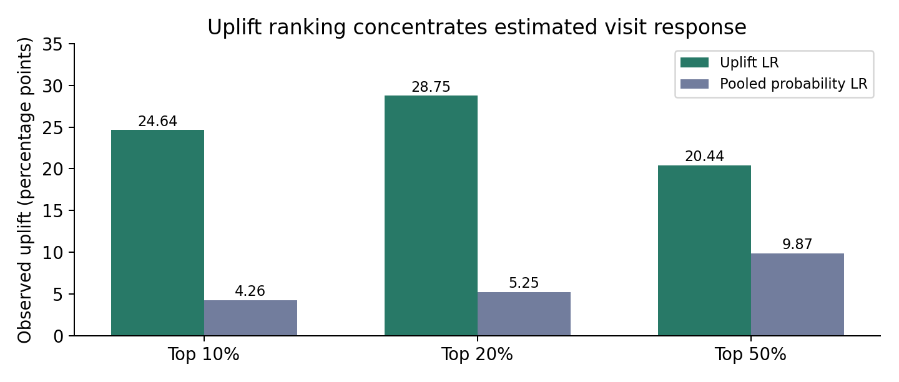

# HCP incremental response targeting

Reproducible specialty-pharma case study by **Sambodhu Pranay Raj**. The goal is to move from predicting which HCPs will prescribe to estimating where an additional rep visit may change prescribing.

## Start here

- **[Detailed Word report](reports/HCP_Targeting_Solution_Report.docx)** — solution, assumptions, methods, synthetic data, results, explanations, limitations and next steps.
- **[Interactive dashboard source](docs/index.html)** — download the repository and open this file, or enable GitHub Pages as described below.
- **[Uplift results](results/uplift/ranking_comparison.csv)** and **[predictive results](results/refit/test_comparison.csv)**.
- **[Upload provenance](reports/upload_manifest.json)** — retained source files, original checksums and excluded duplicates/environment files.

All HCP records and business results are synthetic. The dashboard uses precomputed predictions and works without Python. Existing reasons are grounded templates; the required live LLM rewriting stage is not yet implemented. The restricted-training comparison from the original brief is also pending. These limitations are described in the report.

## Folder structure

| Folder | Contents |
|---|---|
| `scripts/` | Generator, preprocessing, feature split, classifiers, refit, ranking, uplift and reasons |
| `data/raw/` | Uploaded synthetic universe, visit history, summary and separately labelled simulation truth |
| `data/processed/` | Fixed-rule imputation and categorical encoding outputs |
| `data/splits/` | Engineered rows and aligned train/validation/test X, y, treatment and ID files |
| `results/classification/` | Limited-grid validation results and selected per-model artifacts |
| `results/refit/` | Final LR and random forest test metrics, reports and model files |
| `results/uplift/` | Two LR models, test uplift metrics, rankings, curves and uncertainty |
| `results/ranking/` | Probability rankings, >=3 visit subsets and synthetic rep plan |
| `results/reasons/` | Grounded reasons, model-driver audit and LLM prompt records |
| `reports/` | Detailed Word report, figures, upload manifest and rollout guidance |
| `docs/` | Standalone GitHub Pages dashboard and bundled synthetic records |

## Run in VS Code

Open this repository folder in VS Code. Run commands from the repository root, not from scripts/.

```powershell
python -m venv .venv
.\.venv\Scripts\Activate.ps1
python -m pip install -r requirements.txt
```

To reproduce the complete analytical workflow:

```powershell
python .\scripts\generate_hcp_data.py
python .\scripts\preprocess_hcp.py
python .\scripts\feature_engineering_split.py
python .\scripts\train_classifiers.py
python .\scripts\refit_lr_rfc.py
python .\scripts\build_ranking_datasets.py
python .\scripts\train_uplift_lr.py
python .\scripts\explain_hcp.py
```

Each script has project-relative defaults for the folder structure above. Use `--help` for overrides. Keep X, y, treatment and ID rows aligned. Simulation truth, IDs, free text, future outcomes and visit assignment are excluded from predictive feature inputs.

**Model compatibility:** uploaded joblib artifacts were created with scikit-learn 1.9.1. Loading them in another version can fail. The safe portable route is to regenerate models with the commands above, including `train_classifiers.py` before refitting. Do not load untrusted joblib files. The static dashboard never deserializes models.

The five-classifier grid automatically names gradient boosting as its highest validation-AUC model. Final LR use is an explicit simplicity choice; `refit_lr_rfc.py` deliberately refits LR and random forest regardless of the grid's automatic winner. No test tuning is performed by the uplift script.

## Main results

| Synthetic test metric | Uplift LR ranking | Unweighted pooled LR probability ranking |
|---|---:|---:|
| Normalised Qini AUC | 0.0389 | -0.0199 |
| Normalised uplift AUC | 0.0491 | -0.0285 |
| Observed uplift among top 20% | 28.75 percentage points | 5.25 percentage points |

The top-20% uplift interval is approximately 11.79–43.39 percentage points, from 500 bootstrap samples holding fitted models fixed. The test set was previously inspected; this is exploratory synthetic evidence.

The dashboard's current list uses the earlier **balanced** LR classifier, a different baseline from the unweighted pooled LR in the table. Its top 400 and the uplift top 400 share 7 HCPs. Synthetic rep-plan overlap is 211/400 for the current list and 5/400 for uplift. These constructed comparisons establish list differences, not real business impact.



## GitHub Pages

This submission uses a static website, separate from the earlier local dashboard.

1. Open repository **Settings → Pages**.
2. Choose **Deploy from a branch**, then **main** and **/docs**.
3. Save and use the exact website URL GitHub displays after deployment.

Opening the repository shows code. Opening the Pages URL shows the dashboard. A website URL is not claimed until GitHub confirms deployment. To preview locally:

```powershell
python -m http.server 8000 --directory docs
```

Open http://localhost:8000. The dashboard supports territory/stage filters, model comparisons, profiles, grounded reasons, separate rep reviews and a display-only Tier 1 filter. Browser actions are saved only in localStorage and can be exported as CSV; they are not shared adoption tracking.

## Explanation and rollout status

`explain_hcp.py` creates deterministic short reasons backed by each synthetic HCP's recorded facts and paired-LR model contributions. It exports one grounded LLM prompt per flagged HCP; no LLM service call occurs. Model contributions are reference dependent and are not causal feature effects.

Measure rep adoption separately from impact. For rollout, randomise comparable reps/territories to old versus new lists with equal visit capacity, measure 28-day outcomes and report uncertainty. See [rollout plan](reports/ROLLOUT_PLAN.md) and the Word report.

## Source management

The fresh upload replaces the superseded prototype on main. Its prior version is retained on branch `backup-before-fresh-submission-20261105`. The uploaded Python environment, caches, local activity database and duplicate older downloaded packages are excluded. Modelling scripts are preserved with only project-relative path defaults adapted to the organised layout. Uploaded results remain canonical; verification outputs are kept separate.
